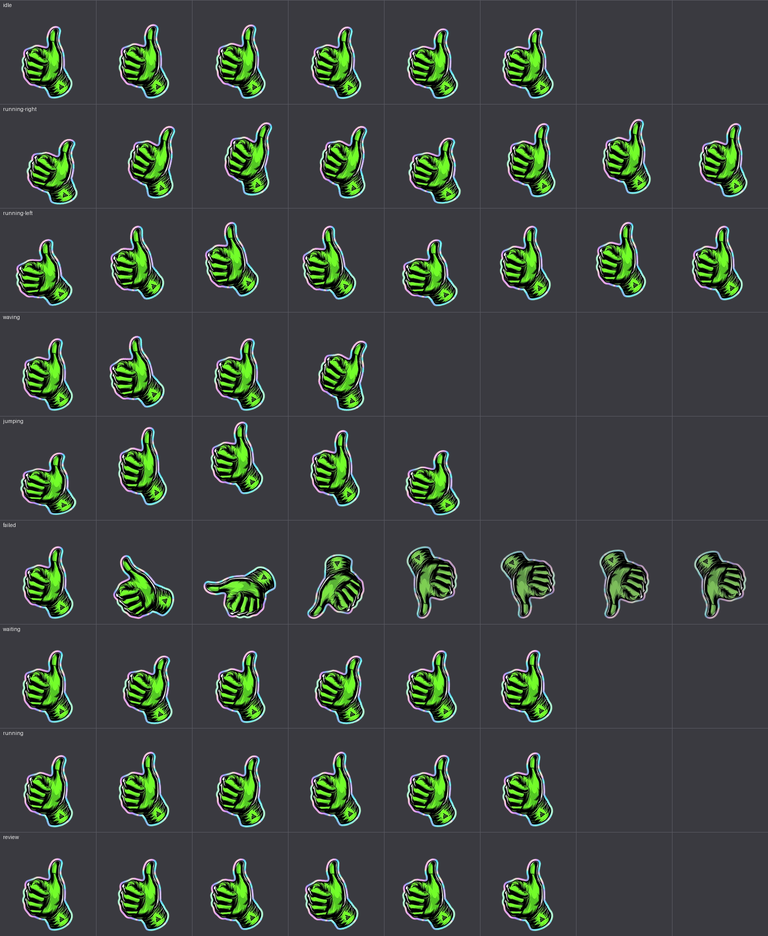

# Guante Verde · mascota de escritorio

El guante verde de Ángel Gaitán convertido en mascota animada para
[Petdex Desktop](https://petdex.dev), Codex y [OpenPets](https://github.com/OpenPetsHQ/openpets).
Reacciona a lo que hace Claude Code: salta con el pulgar arriba cuando algo sale bien y
gira a pulgar abajo cuando algo falla.



| Reposo | Éxito | Error | Trabajando |
| --- | --- | --- | --- |
|  |  |  |  |

## Instalar

```sh
gh repo clone armandofcom/claude-pets-angel
cd claude-pets-angel
./install.sh
```

Después:

1. Descarga [Petdex Desktop](https://petdex.dev/download) y ábrelo.
2. Pon el ratón sobre la mascota y pulsa <kbd>Cmd</kbd>+<kbd>,</kbd>.
3. En **Pets** elige **Guante Verde**.
4. En **Agents** conecta **Claude Code**.

Para quitarla: `./install.sh --desinstalar`.

### Con Claude Code

Abre Claude Code en cualquier carpeta y pídele:

> Instala la mascota de https://github.com/armandofcom/claude-pets-angel siguiendo su CLAUDE.md

Claude clonará el repo, ejecutará `install.sh` y te dirá el paso final en Petdex Desktop.

## Qué hace cada animación

| Fila | Estado | Cuándo sale | Movimiento |
| --- | --- | --- | --- |
| 0 | idle | Sin actividad | Respira y se balancea |
| 1 | running-right | Arrastras la mascota a la derecha | Saltitos inclinado a la derecha |
| 2 | running-left | Arrastras la mascota a la izquierda | Saltitos inclinado a la izquierda |
| 3 | waving | Saludo o aviso | Se mece de lado a lado |
| 4 | jumping | Tarea terminada bien | Se agacha y salta |
| 5 | failed | Algo falló | Gira a pulgar abajo y pierde color |
| 6 | waiting | Claude espera tu permiso | Da toquecitos hacia delante |
| 7 | running | Claude ejecuta o edita | Vibra con energía |
| 8 | review | Claude piensa o revisa | Se inclina despacio |

## Formato

- `pets/guante-verde/pet.json` y `pets/guante-verde/spritesheet.webp`.
- Atlas 8x9 de celdas 192x208 (1536x1872 px), el formato de Codex que también aceptan Petdex y OpenPets.
- Validado con `validate_atlas.py` de la skill `hatch-pet` de Codex: sin errores ni avisos.
- `tools/generar_atlas.py` regenera el atlas desde el logo (`tools/guante-verde-logo.webp`).

## Derechos

El guante verde es el logo de Ángel Gaitán. El arte no se puede redistribuir ni subir a galerías
públicas sin su permiso. El script de `tools/` se puede reutilizar libremente.
