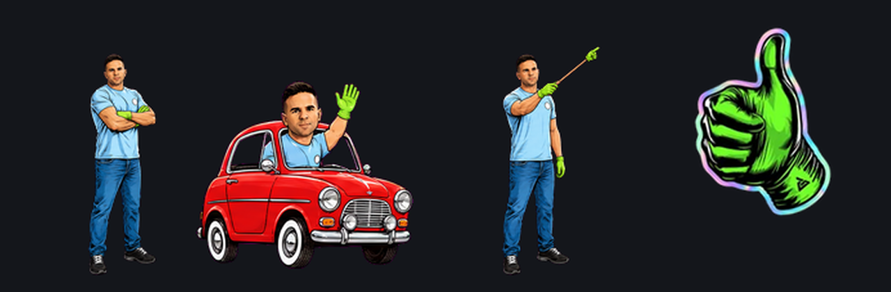
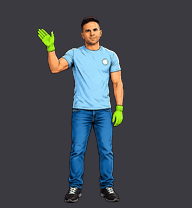
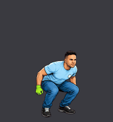
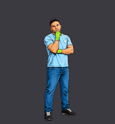
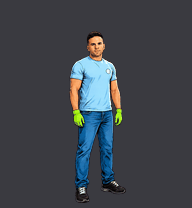

<p align="center">
  
</p>

<h1 align="center">Mascotas de Ángel Gaitán</h1>

<p align="center">
  Dos compañeros animados de escritorio que reaccionan a lo que hace tu agente de código.<br>
  Para <a href="https://petdex.dev">Petdex Desktop</a>, Codex y <a href="https://github.com/OpenPetsHQ/openpets">OpenPets</a>.
</p>

<p align="center">
  
  
  
  
</p>

<p align="center"><a href="#english">English version below</a></p>

## Las mascotas

| | **Ángel Gaitán** | **Guante Verde** |
| --- | :---: | :---: |
| Reposo |  |  |
| Saludo |  |  |
| La arrastras |  |  |
| Todo OK |  |  |
| Revisando |  |  |
| Algo falló |  |  |

- **Ángel Gaitán:** el mecánico de TikTok en versión ilustrada, con sus inseparables guantes verdes,
  su coche rojo clásico y un puntero con un guante en la punta.
- **Guante Verde:** el logo del guante, convertido en pegatina viva.

## Instalar

### Con Claude Code (lo más fácil)

Abre Claude Code en cualquier carpeta y pídele:

> Instala la mascota de https://github.com/armandofcom/claude-pets-angel siguiendo su CLAUDE.md

### A mano (macOS y Linux)

```sh
git clone https://github.com/armandofcom/claude-pets-angel.git
cd claude-pets-angel
./install.sh                # las dos
./install.sh angel-gaitan   # solo Ángel
./install.sh guante-verde   # solo el guante
```

Las copia en `~/.petdex/pets/` (Petdex Desktop) y `~/.codex/pets/` (Codex y OpenPets).
Para quitarlas: `./install.sh --desinstalar` o `./install.sh --desinstalar angel-gaitan`.

### A mano (Windows, PowerShell)

```powershell
git clone https://github.com/armandofcom/claude-pets-angel.git
cd claude-pets-angel
foreach ($dest in "$env:USERPROFILE\.petdex\pets", "$env:USERPROFILE\.codex\pets") {
  New-Item -ItemType Directory -Force $dest | Out-Null
  Copy-Item -Recurse -Force pets\* $dest
}
```

### Verla en pantalla

1. Descarga [Petdex Desktop](https://petdex.dev/download) y ábrelo.
2. Pon el ratón sobre la mascota y pulsa <kbd>Cmd</kbd>+<kbd>,</kbd> (<kbd>Ctrl</kbd>+<kbd>,</kbd> en Windows y Linux).
3. En **Pets** elige **Ángel Gaitán** o **Guante Verde**.
4. En **Agents** conecta **Claude Code** (o Codex, Cursor…).

## Cómo reacciona

| Estado | Cuándo sale | Ángel Gaitán | Guante Verde |
| --- | --- | --- | --- |
| `idle` | Sin actividad | Brazos cruzados: respira, parpadea y se balancea un poco | Se mece suavemente |
| `running-right` / `running-left` | La arrastras | Conduce su coche rojo clásico y saluda por la ventanilla | Da saltitos inclinado |
| `waving` | Saludo o aviso | Saluda con el guante: «¡Hola, compañero!» | Se mece: «¡Hola, compañero!» |
| `jumping` | Tarea terminada bien | «Todo OK»: seña de OK con guiño, doble pulgar arriba y saltito | Salta |
| `failed` | Algo falló | Se lleva la mano a la cara | Gira a pulgar abajo y pierde color |
| `waiting` | El agente espera tu permiso | Levanta la mano bien alta: «¡aquí!» | Da toquecitos hacia delante |
| `running` | El agente ejecuta o edita | Se ajusta los guantes y flexiona los dedos | Vibra con energía |
| `review` | El agente piensa o revisa | Señala con un puntero con un guante verde en la punta | Se inclina despacio |

Hojas completas: [Ángel](preview/angel-gaitan/contact-sheet.png) · [Guante](preview/guante-verde/contact-sheet.png).

## Cómo se hicieron

- **Formato:** cada mascota es `pet.json` + `spritesheet.webp`, un atlas 8x9 de celdas de 192x208
  (1536x1872 px). Es el formato de las mascotas de Codex que también leen Petdex y OpenPets.
- **Guante Verde:** sin IA. [`tools/generar_atlas.py`](tools/generar_atlas.py) anima el logo real con
  rebotes, inclinaciones, salto con estiramiento y giro a pulgar abajo.
- **Ángel Gaitán:** ilustración generada con GPT Image 2 (en Higgsfield) a partir de fotos públicas,
  una tira por animación sobre fondo magenta ([`fuentes/angel-gaitan/`](fuentes/angel-gaitan/)).
  [`tools/procesar_tiras.py`](tools/procesar_tiras.py) quita el fondo, separa las poses e iguala
  tamaño y suelo antes de montar el atlas.
- **Calidad:** los dos atlas pasan el validador `validate_atlas.py` de la skill `hatch-pet` de Codex
  sin errores ni avisos, y ningún fotograma se sale de su celda.

Para regenerar los atlas:

```sh
python3 -m venv .venv && .venv/bin/pip install pillow numpy scipy
.venv/bin/python tools/generar_atlas.py --logo tools/guante-verde-logo.webp --salida salida-guante
.venv/bin/python tools/procesar_tiras.py --tiras fuentes/angel-gaitan --salida salida-angel
```

## Estructura

```text
pets/
  angel-gaitan/   pet.json + spritesheet.webp
  guante-verde/   pet.json + spritesheet.webp
preview/          banner, GIF y hojas de contactos
fuentes/          tiras originales del avatar
tools/            scripts que generan los atlas
install.sh        instalador (macOS y Linux)
CLAUDE.md         instrucciones para que Claude Code las instale
```

## Licencia y derechos

- **Código** (`tools/`, `install.sh`): [MIT](LICENSE).
- **Arte** (`pets/`, `preview/`, `fuentes/` y el logo): el guante verde es la marca de Ángel Gaitán y el
  avatar reproduce su imagen. Todos los derechos reservados ([NOTICE](NOTICE)). Puedes instalarlas y
  usarlas, pero no modificarlas, redistribuirlas ni usarlas en otros proyectos sin permiso.
- El formato de mascota y la app son de [Petdex](https://github.com/crafter-station/petdex) y
  [OpenPets](https://github.com/OpenPetsHQ/openpets).

---

## English

Two animated desktop companions based on Spanish mechanic and creator **Ángel Gaitán**: an illustrated
avatar wearing his signature green gloves, and his **green glove** logo brought to life. They react to
your coding agent (thinking, working, waiting for approval, success, failure) in
[Petdex Desktop](https://petdex.dev), Codex and [OpenPets](https://github.com/OpenPetsHQ/openpets).

```sh
git clone https://github.com/armandofcom/claude-pets-angel.git
cd claude-pets-angel
./install.sh                # both pets (or: ./install.sh angel-gaitan | guante-verde)
```

Then open Petdex Desktop, press <kbd>Cmd</kbd>+<kbd>,</kbd> over the pet, pick it under **Pets** and connect
your agent under **Agents**. Or just ask Claude Code: *"Install the pet from
https://github.com/armandofcom/claude-pets-angel following its CLAUDE.md"*.

Code is MIT. Artwork (glove logo and avatar) belongs to Ángel Gaitán, all rights reserved.
